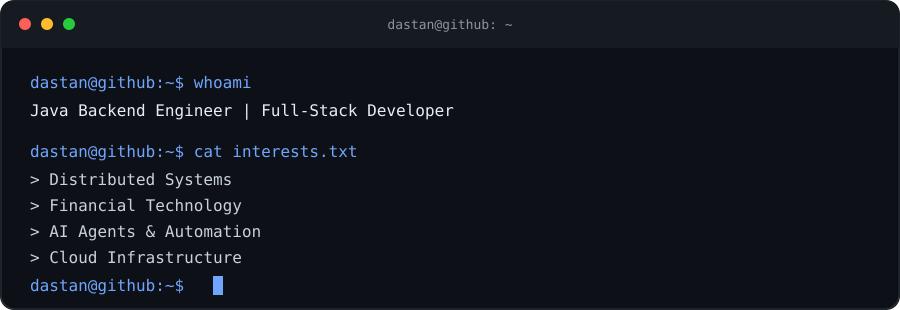
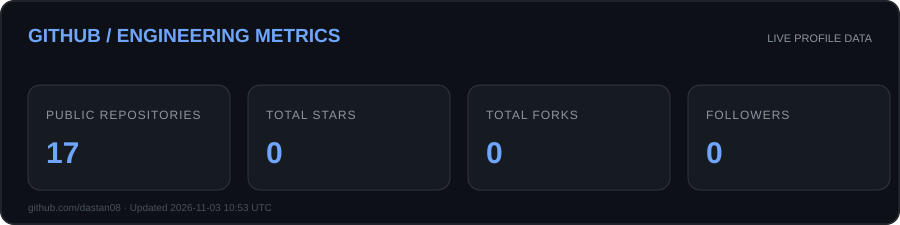
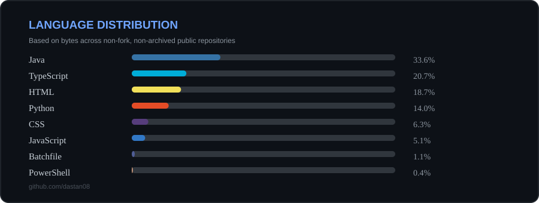

  

### GitHub Metrics

  

##  TECH ARSENAL

<table>
  <tr>
    <td align="center" width="50%">
      <h3>💻 Languages</h3>
      
    </td>
    <td align="center" width="50%">
      <h3>⚙️ Backend Development</h3>
      
    </td>
  </tr>
  <tr>
    <td align="center" width="50%">
      <h3>🎨 Frontend & Mobile</h3>
      
    </td>
    <td align="center" width="50%">
      <h3>🗄️ Databases & Infrastructure</h3>
      
       
      
    </td>
  </tr>
</table>

## 📡 ENGINEERING DASHBOARD

  
  
  

### GitHub Metrics

  
  

### Language Distribution

  

### Contribution Activity

  

  <i>Measure progress. Build consistently. Keep shipping.</i>

##  FEATURED PROJECTS

  <table>
    <tr>
      <td width="50%" valign="top">
        <h3>CypherCFO</h3>
        <strong>Financial Intelligence Platform</strong>
        
A financial SaaS platform designed to transform business data into actionable financial insights, with a spreadsheet-like analysis experience.

        

          
          
          
          
          
        

        Flagship project · Financial data modelling · Tally integration
      </td>
      <td width="50%" valign="top">
        <h3>Revent</h3>
        <strong>Event Management Platform</strong>
        
A collaborative event management application. Contributed across backend services, mobile development, integrations and infrastructure.

        

          
          
          
          
        

        Collaborative contribution · Backend · Mobile · DevOps
      </td>
    </tr>
    <tr>
      <td width="50%" valign="top">
        <h3>Coding Agent</h3>
        <strong>AI-Powered Coding Assistant</strong>
        
An experimental coding agent built around local LLMs, with an agent workflow for coding tasks.

        

          
          
          
          
        

        <a href="https://github.com/dastan08/Coding-Agent">↗ View Repository</a>
      </td>
      <td width="50%" valign="top">
        <h3>LAN Share</h3>
        <strong>Local Network File Sharing</strong>
        
A local network file-sharing application built with a Spring Boot backend and React frontend.

        

          
          
          
        

        <a href="https://github.com/dastan08/Lan-Share">↗ View Repository</a>
      </td>
    </tr>
    <tr>
      <td width="50%" valign="top">
        <h3>Gmail Order Parser</h3>
        <strong>Food & Grocery Spend Tracker</strong>
        
Parses order emails and automates expense tracking using scheduled processing and a local database.

        

          
          
          
        

        <a href="https://github.com/dastan08/Automated-Expense-Reporting-System">↗ View Repository</a>
      </td>
      <td width="50%" valign="top">
        <h3>⚙️ More in Progress</h3>
        <strong>Building, experimenting, learning.</strong>
        
Exploring backend engineering, distributed systems, developer tooling and practical AI applications.

        <a href="https://github.com/dastan08?tab=repositories">↗ Explore All Repositories</a>
      </td>
    </tr>
  </table>

